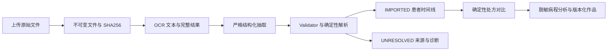

# 当前架构与数据约束

Web 使用 Next.js，后端 FastAPI，数据通过 SQLAlchemy/Alembic 进入 PostgreSQL；Celery 使用 Redis 协议连接 Valkey。存储为本机内容寻址文件适配器。Web 的服务端代理访问 API，读取临床资料与修改接口均需认证。

摄取冻结：主要路径是 AI 理解、规则门控；原有 JNU 两类解析器仅作冻结 fallback/回归参考。验证在任何患者和就诊写入前运行。可追溯但未映射药名为 pending/canonical NULL；OCR 证据不可追溯的身份阻断。规格未知可以保持 NULL，不能猜克数。UNRESOLVED 不产生已提交临床行。相同来源 hash 和重试不得重复产生患者、就诊或处方。

PatientIdentity 保存加密身份，Patient 保存临床关联；患者匹配优先医院 + MRN 指纹。年龄属于本次 Encounter，来源 Document 与 Encounter 为多对一。原始证据、服务原始结果和衍生结果分别保留。衍生值可按版本重算，但不覆盖来源。

Prescription Diff 使用确定性算法：canonical 基础药身份匹配先于炮制；未归一化仅允许唯一的规范化原名精确匹配。`calculated_dose_g` 且 `dose_scope=per_decoction` 才比较；任何一侧未知即 UNKNOWN。炮制变化独立记录，重复歧义拒绝。

病程上下文只覆盖明确选定并排序的就诊，直接消费相邻确定性 diff。既往 AI 推断不能升格为来源事实。分析与写作严格验证证据键、就诊和 provenance；任何违规拒绝整体输出。写作保存追加 `apprenticeship_note_versions`，原文、AI 草稿、用户草稿、最终版永久保留。依据块保留来源就诊；老师口述必须有对应 student_note 证据。

完整模型与迁移在 `apps/api/app/models/`、`apps/api/alembic/`。运行 API 的 `/openapi.json` 提供当前契约。工程测试使用合成 fixtures，不构成真实病例准确率分母。
